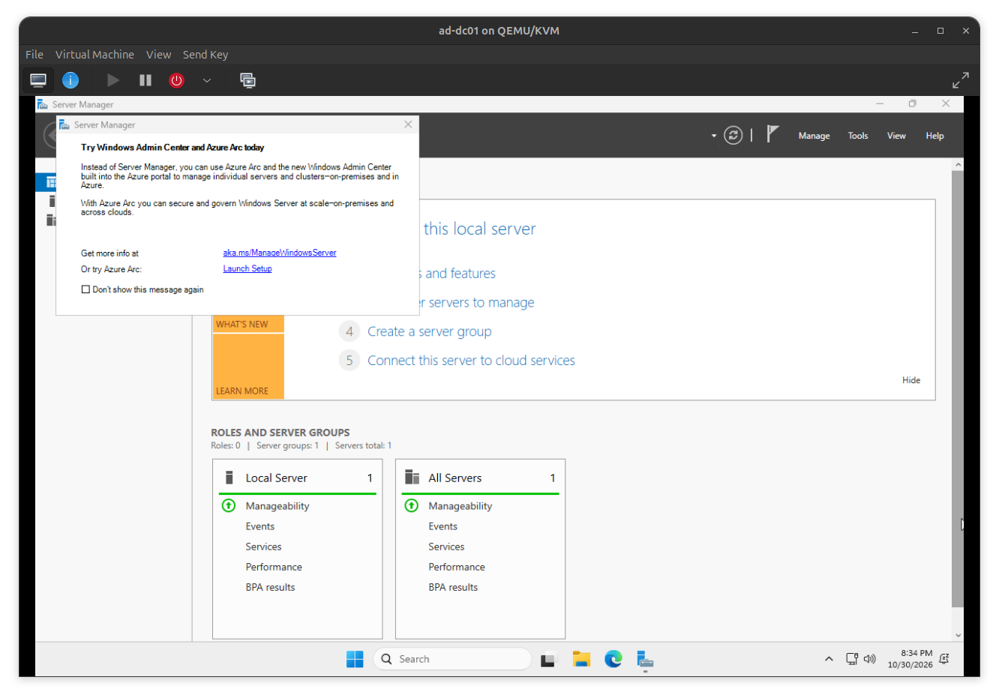
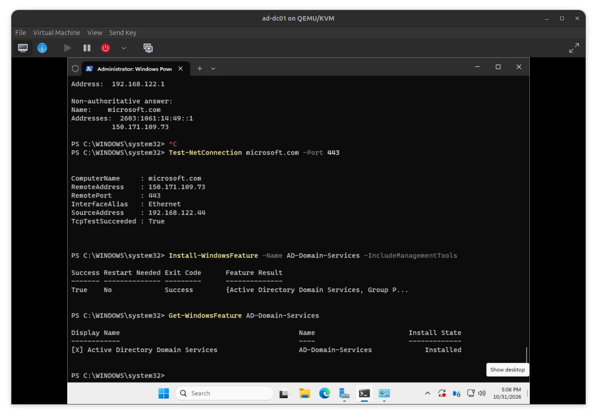
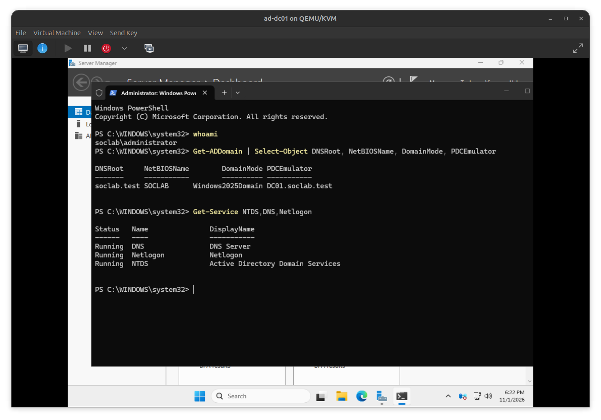

# Active Directory SOC Lab

**Status: In progress — Domain created and verified; Windows client installed, domain join pending.**

I am building this lab to understand Windows domain administration and investigate identity-related activity as I prepare for a SOC analyst internship. I perform the VM setup and lab exercises myself, using step-by-step guidance, and document what I can verify.

This project follows my [Wazuh SOC lab](https://github.com/FloresFreddyGH/wazuh-soc-lab) and [Azure security lab](https://github.com/FloresFreddyGH/azure-security-lab).

## Completed on October 30, 2026

- Checked host CPU, memory, storage, and existing VMs
- Created `ad-dc01` in virt-manager on Ubuntu using QEMU/KVM
- Allocated 4 vCPUs, 6144 MiB RAM, and an 80 GiB virtual disk
- Selected Q35 and UEFI firmware, with the default NAT network
- Installed Windows Server 2025 Standard Evaluation (Desktop Experience)
- Completed the first login and reached Server Manager

## Completed on October 31, 2026

- Renamed Windows to `DC01` and verified the hostname
- Resolved missing VirtIO serial driver and installed guest tools; host-to-VM clipboard copying now works
- Added a persistent and live libvirt DHCP reservation for DC01
- Applied and verified a static IPv4 address inside Windows
- Verified gateway reachability, DNS resolution, and outbound TCP connectivity on port 443
- Installed AD DS and its management tools; installation succeeded with no restart required

At the end of October 31, only the role was installed. Promotion was completed in the next session.

## Completed on November 1, 2026

- Verified DC01 time synchronization, changed its display time zone to Eastern, and checked updates and evaluation activation
- Created the `soclab.test` forest/domain with NetBIOS name `SOCLAB` and Windows Server 2025 functional levels
- Verified domain sign-in, AD DS/DNS/Netlogon services, DNS host and service records, SYSVOL/NETLOGON shares, and external name resolution
- Created the SOCLab OU with LabUsers, Workstations, and Groups; corrected an accidentally nested OU
- Created the fictional employee account Lamine Yamal and added it to `GG_Lab_Employees`
- Installed Windows 11 Enterprise Evaluation in a separate client VM and reached the desktop as local `labadmin`

## Environment

| Component | Configuration | Status |
|---|---|---|
| Ubuntu host | Intel i5-14400F, 16 logical CPUs, 30 GiB RAM; 763 GB free disk at initial check | Verified |
| `ad-dc01` | Windows Server 2025, 4 vCPUs, 6 GiB RAM, 80 GiB disk | Domain controller and DNS server for soclab.test |
| Existing Wazuh server | From the previous lab | Planned monitoring destination; not connected to this server yet |
| `ad-client01` | Windows 11 Enterprise Evaluation, 2 vCPUs, 6 GiB RAM, 80 GiB disk | Desktop reached; not domain joined |

The VM is named `ad-dc01` in virt-manager and Windows is named `DC01`. Its static IPv4 address is `192.168.122.44/24`, with gateway `192.168.122.1`. After promotion, its DNS client uses its own service through `::1` and `127.0.0.1`. A matching DHCP reservation protects that address from reassignment. The default NAT network is shared with existing lab VMs; it is not a dedicated isolated AD network.

## Planned next steps

1. Verify the client hostname and rename it to CLIENT01 if necessary
2. Check client time zone, synchronization, updates, activation, and guest tools
3. Configure client DNS to use DC01, verify domain discovery, and join soclab.test
4. Move the client object into Workstations and test the employee's first domain sign-in
5. Configure security auditing and Wazuh collection
6. Generate controlled authentication and account/group changes and investigate the resulting records

Client domain join, policy exercises, and SOC detections are still pending. Celebrity-inspired names represent fictional lab accounts, not actual affiliations.

## Documentation

- [Lab journal](docs/lab-journal.md)
- [Setup notes and resume point](docs/setup-notes.md)
- [Screenshot index](screenshots/README.md)
- [Portfolio summary](docs/portfolio-summary.md)
